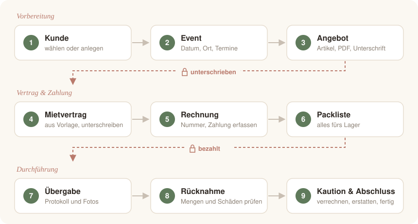

> [!NOTE]
> **Warum es mietly gibt**
>
> Meine Mama möchte sich mit einem Verleih selbstständig machen – und Computer sind nicht ihre Welt. Damit sie sich auf ihre Kundinnen und Kunden konzentrieren kann statt auf Zettel und Tabellen, habe ich mit mietly den gesamten Ablauf in einer einzigen Anwendung festgehalten: vom ersten Angebot bis zur zurückgezahlten Kaution.
>
> Ganz ehrlich: Der Code ist zu 100 % mit KI entstanden. Mit Sicherheitskonzepten in Software kenne ich mich aus – das Programmieren selbst ist aber nicht meins. Und neben einem 40-Stunden-Job bleibt mir keine Zeit, diese App allein zu schreiben oder das Programmieren von Grund auf zu lernen.
>
> Deshalb sage ich auch ehrlich: **Bitte stell mietly nicht offen ins Internet.** Nutze es am besten nur im lokalen Netz oder von unterwegs über ein VPN. So weit traue ich der KI nicht.
>
> Wenn dir beim Lesen oder Ausprobieren etwas auffällt, freue ich mich über einen Hinweis. 💛

<div align="center">


# mietly

**Die Verwaltung für Event- und Dekorationsverleihe.**<br>
Vom ersten Angebot bis zur zurückgezahlten Kaution – auf deinem eigenen Server.

[](https://github.com/devthoko/mietly/releases/latest)


[Installation](#-installation) · [Funktionen](#-was-mietly-kann) · [Ablauf](#-der-weg-eines-auftrags) · [Betrieb](#-betrieb) · [Dokumentation](#-dokumentation)

</div>

---

## 🚀 Installation

Ein Befehl auf einem frischen **Ubuntu 26.04 LTS** Server:

```bash
curl -fsSL https://github.com/devthoko/mietly/releases/latest/download/install.sh | sudo bash
```

Danach `https://<IP-des-Servers>` im Browser öffnen und mit dem angezeigten Erstzugang anmelden.

> [!TIP]
> Derselbe Befehl **aktualisiert** eine bestehende Installation – mit Backup vorab und automatischem Rücksprung, falls etwas schiefgeht.

<details>
<summary>Was der Installer einrichtet</summary>

<br>

PostgreSQL · nginx mit HTTPS · Systemdienst · nächtliches Backup · E-Mail-Wiederholung · Druckdienst (CUPS) · deutsche Sprache und Zeitzone.
Die Anwendung startet **leer** – ohne Kunden, Aufträge oder Beispieldaten. Das Paket wird vor dem Start per SHA-256 geprüft.

Weitere Wege (Installationsdatei, feste Version, Umzug): [docs/installation.md](docs/installation.md)

</details>

---

## ✨ Was mietly kann

<table>
<tr>
<td width="50%" valign="top">

### 🗂️ Auftragsakte in 9 Schritten
Jeder Auftrag zeigt, wo er steht, was fehlt und was als Nächstes zu tun ist – mit direktem Knopf zur nächsten Aktion.

</td>
<td width="50%" valign="top">

### ✍️ Unterschrift auf dem Tablet
Angebot, Vertrag und Übergabeprotokoll direkt digital unterschreiben – oder das unterschriebene PDF hochladen.

</td>
</tr>
<tr>
<td valign="top">

### 📦 Keine Doppelbuchungen
Verfügbarkeit je Artikel und Paket im Mietzeitraum, inklusive Puffertagen für die Reinigung.

</td>
<td valign="top">

### 🧾 Saubere Rechnungen
Lückenlose Nummern, § 14 UStG, Kleinunternehmerregelung, Storno- und Nachberechnung, unveränderlich nach GoBD.

</td>
</tr>
<tr>
<td valign="top">

### 💶 Kaution im Griff
Schäden und Fehlmengen mit der Kaution verrechnen oder nachberechnen – mit fertiger Abrechnung für den Kunden.

</td>
<td valign="top">

### 📨 Mail & Druck
PDFs per E-Mail mit automatischer Wiederholung bei Störungen. Netzwerkdrucker per IP – Treiber kommt automatisch.

</td>
</tr>
<tr>
<td valign="top">

### 📱 Desktop, Tablet, Handy
Zwei Gestaltungen (warm oder klar), Hell- und Dunkelmodus, große Touch-Flächen für das Lager.

</td>
<td valign="top">

### 🔐 Deine Daten bleiben bei dir
Läuft im eigenen Netz, ohne Cloud. Tägliche Backups, Wiederherstellung mit einem Befehl, optional verschlüsselt in die Nextcloud.

</td>
</tr>
</table>

→ Alle Funktionen im Detail: [docs/funktionen.md](docs/funktionen.md)

---

## 🧭 Der Weg eines Auftrags

<p align="center"></p>

Vier Regeln sind **fest eingebaut** und gelten für alle – auch für Administratoren:

| 🔒 | Erst wenn … | … geht es weiter mit |
|---|---|---|
| 1 | das Angebot unterschrieben ist | dem Mietvertrag |
| 2 | der Mietvertrag unterschrieben ist | der Rechnung |
| 3 | die Rechnung vollständig bezahlt ist | der Übergabe |
| 4 | das Übergabeprotokoll unterschrieben ist | dem Abschluss der Übergabe |

---

## 🛠️ Betrieb

| Aufgabe | Befehl |
|---|---|
| Zustand prüfen | `sudo mietly status` |
| Backup jetzt | `sudo mietly backup` |
| Backup einspielen | `sudo mietly restore <datei>` |
| Update | Installations-Einzeiler erneut ausführen |
| Zurück zur Vorversion | `sudo mietly rollback` |
| Protokoll ansehen | `sudo mietly logs -f` |

Backups laufen jede Nacht automatisch (14 tägliche, 8 wöchentliche, 12 monatliche).
Details zu Konfiguration, Zertifikat, Backup und Fehlerbehebung: [docs/betrieb.md](docs/betrieb.md)

---

## 📚 Dokumentation

| | |
|---|---|
| 📥 [Installation & Updates](docs/installation.md) | Voraussetzungen, Erstzugang, Updates, Umzug |
| 🛠️ [Betrieb](docs/betrieb.md) | Konfiguration, Backup, Wiederherstellung, Fehlerbehebung |
| ✨ [Funktionen](docs/funktionen.md) | Alles, was mietly kann |
| 👩‍💻 [Entwicklung](docs/entwicklung.md) | Tests, Vorschau, Version veröffentlichen |
| ⚖️ [Rechtliches](docs/recht.md) | Rechnungen, GoBD, DSGVO, digitale Unterschrift |

---

<div align="center">
<sub>

**Technik:** Python · Django 5.2 LTS · PostgreSQL · nginx · htmx · WeasyPrint<br>
Alle Schriften und Skripte werden lokal ausgeliefert – keine externen Abrufe. · [Lizenzen der Fremdbestandteile](licenses/README.md)

</sub>
</div>
